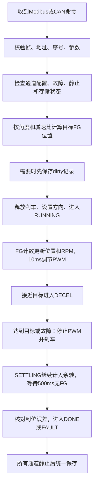

# 固件功能与运行逻辑（2026-10-10）

本说明依据当前工作区源码，不代表硬件实测结果。实际工程路径为 E:/Date_save/embedded_code/GD32Projects/GD32F303/GD32F303VET6_MotorControl。本文件描述当前源码事实；构建、烧录和实测分别按日期记录，不将静态分析当作硬件验收。

## 1. 故障4的新规则

每路使用已经 CONFIG 提交成功的减速比，未提交的暂存配置不生效；保存失败仍沿用旧配置。有效值为516、290、82。未配置有效减速比时不触发 F_UNEXPECTED（故障4），没有固定10脉冲回退。

按减速前每转6个FG上升沿计算，累计非预期输出轴活动量=N×360/(6×gear)度。小于等于10度不报警，严格大于10度才报警。软件使用整数预算 floor(100×6×gear/3600)，没有浮点舍入；100的单位是0.1度。

| 已生效减速比 | 容忍累计脉冲 | 首次报警脉冲 | 首次报警对应角度 |
|---|---:|---:|---:|
| 516 | 0～86 | 87 | 约10.1163度 |
| 290 | 0～48 | 49 | 约10.1379度 |
| 82 | 0～13 | 14 | 约10.2439度 |
| 0或无效 | 不触发故障4 | 无 | 无法换算 |

仅以已生效减速比决定该保护，不额外要求 enabled=1；已配置但禁用的通道仍有非预期活动保护。

- 这是累计活动量，不是净偏移。来回晃动都计数，单线FG不能辨别外力方向。
- 正常受控运动、自检当前被测通道及允许余转按命令方向计入位置，不消耗非预期预算。
- 静止间隔、普通运动、自检往返和 CONFIG 不清累计。初始化/重启、成功 CLEAR_FAULT、成功 ZERO 清累计；每次超限事件、自动恢复及人工调整进入也重置相关累计；失败的命令不清。
- 未配置时仍记录原始和非预期累计，并更新最近活动时间；随后配置成功不会抹掉旧累计，下一次非预期脉冲按新减速比判断。要开始全新观察周期，可在静止后明确清故障，无需为了清累计而重设零点。
- 10度以内不新增位置无效逻辑；超过阈值沿用原故障处理：停止PWM、刹车、使位置失效并安排保存。
- 捕获错误、无反馈、运动超时、到位误差、存储错误等保持原判断。未配置时的捕获错误保护仍生效。
- 自检中其他通道活动在主循环和1ms中断中使用相同角度预算。未配置的其他通道不会仅因FG活动触发故障4或这条自检中止路径；捕获错误仍立即停机。

实现：[robot.h](../BSP/robot.h) 的 ROBOT_UNEXPECTED_FG_DDEG、ROBOT_FG_PULSES_PER_MOTOR_REV；[robot.c](../BSP/robot.c) 的 robot_unexpected_fg_limit/unexpected_edges；[robot_port.c](../BSP/robot_port.c) 的 drive/robot_selftest_safety_tick。协议寄存器、命令号及Flash记录格式不变。

## 2. 当前固件提供什么功能

| 功能 | 当前实现 |
|---|---|
| 四路电机 | M1～M4物理通道固定，每路配置启用、关节角色、减速比、方向反相、RPM |
| 通信 | CH340连接USART0，115200 8N1的Modbus RTU；或CAN命令/寄存器接口。按启动时加载的协议选择其一，不同时运行两套入口 |
| 设备识别 | 读取芯片96位UID，供上位机绑定不同板卡 |
| 角度运动 | 固件MOVE为相对输出轴角度，单位0.1度、单次±360度；正负决定逻辑方向并叠加反相。绝对目标由ROS2/上位机换算差值 |
| 速度控制 | 减速前400～8000RPM，默认8000；10ms周期调节PWM，靠近目标时减速；不是指定到位时间的轨迹控制 |
| 停止与刹车 | 单路STOP、STOP_ALL、单路BRAKE接合/释放；换方向/刹车前先停止PWM |
| 设零与位置 | 无零点传感器；ZERO把当前姿态定义为零并保存。相对MOVE允许无有效零点，但保持位置无效，不自动设零 |
| 自检 | 单路或M1→M4逐路检查；上电不自动执行。反馈不足表示无响应/不足，不等价于未连接 |
| 保存 | 板上Flash日志保存配置、位置和请求身份；运动前dirty，全部静止后保存完成状态；dirty重启位置无效，不自动续跑 |
| 故障 | 1反馈丢失、2运动超时、3捕获错误、4非预期活动、5位置越界/到位超差、6存储故障枚举、7自检失败；同时读取独立storage_error标志 |
| 去重 | 协议版本2完整命令帧直接执行；序号0自动分配，非零序号提供去重。不再发送旧A55A提交帧 |

方向/刹车GPIO目前均是推挽输出，M3 BRAKE是PD2。以下为源码映射，不是本轮电压测量结果。

| 通道 | PWM | DIR | BRAKE | FG |
|---|---|---|---|---|
| M1 | PD12/TIMER3_CH0 | PE15 | PE13 | PB10/TIMER1_CH2 |
| M2 | PD13/TIMER3_CH1 | PC5 | PA7 | PE11/TIMER0_CH1 |
| M3 | PD14/TIMER3_CH2 | PD3 | PD2 | PB4/TIMER2_CH0 |
| M4 | PD15/TIMER3_CH3 | PB8 | PB5 | PA0/TIMER1_CH0 |

PWM高为停止、低电平时间控制运行；BRAKE低为制动、高为释放。DIR低/高对应电气方向，关节向前/向后需结合安装与反相确认。映射见[motor_pins.h](../BSP/motor_pins.h)，驱动见[motor_io.c](../BSP/motor_io.c)。源码中的旧引脚注释不能替代当前宏和初始化实现。

## 3. 启动和主循环

1. 启动保护尽早设置停止输出；进入main后再调用robot_emergency_stop。这不能保证CPU退出硬件复位前的引脚电平。
2. 初始化SysTick、GPIO、PWM、Flash存储与芯片UID；加载有效记录，否则使用默认未配置通道。
3. 恢复保存位置；dirty记录不能恢复有效零点。初始PWM停止、刹车接合，不自动MOVE或自检。
4. 初始化FG捕获，按协议配置打开USART0或CAN。
5. main持续调用robot_port_update和capture_debug_update，不采用阻塞式运动循环。

robot_port_update先获取一致的FG计数/错误快照；如自检中断已截断输出，先消费截断时快照，下一轮再消费余转计数。随后robot_update推进四路状态机、保护和保存，最后处理通信。启用的按键停机路径还会在循环前后检查；当前默认按键急停关闭。

## 4. 一次MOVE如何执行

每路状态0未就绪、1空闲、2运行、3减速、4等待静止、5完成、6故障、7自检、8人工调整。正常到位误差阈值为5度。非预期活动阈值10度与到位误差5度是两个不同判断，不互相替代。命令应答只表示接受，需轮询状态、故障、位置及dirty/storage_error/pending_save确认结果。

## 5. 自检及BRAKE限制

单路自检要求该路启用并配置减速比；整板自检可对尚未配置的四个物理输出逐路探测。两者启动前均检查全板静止、故障和存储条件。PWM每10ms增加1个百分点，最大低电平占空比10%，每程通电最多2s，达到脉冲目标可以提前停止。

去程收到3个脉冲后停机、等待余转结束；以去程加余转的总脉冲作为回程目标，停稳后反向返回。记录出程、回程及残差，残差本身不再作为失败依据。无/不足反馈在静止确认后继续后续通道；捕获错误、其他通道超阈值、停止异常等中止批次。自检结果是最近一次测试，不是持续在线检测，也不能凭单路FG保证机械实际返回原位。

BRAKE释放命令不会自动设零，也不会关闭非预期FG保护。手动推动超过新阈值仍会故障并刹车；阈值以内不报警不能证明角度读数准确。ROS2通过服务提供这些操作，模拟器已采用相同10°累计规则；真实行为仍按实际烧录版本与测量核对。

## 6. 验证与下载后检查

历史构建与边界测试见 [阈值验证记录](history/Robot_故障4角度阈值验证记录.md)，新ROS2接口见 [度数验证](ROS2_度数接口验证记录.md)。下载前确认日志区是否保留；下载后先只读核对UID、有效配置、位置有效与保存三标志。

## 2026-10-10人工调整与故障4恢复更新

新增操作码12、能力寄存器0010和每路+30模式查询。故障4每次重新累计>10°构成事件：5000ms内1～2次到期自动清除，第3次重启窗口；保持停止、制动及位置无效。人工调整暂停该路故障4、冻结有符号位置，并独占整板运动。完整报文、ROS2服务、退出及保存步骤以[人工调整与故障4恢复](Robot_人工调整与故障4恢复.md)为准，历史日志不改写。
